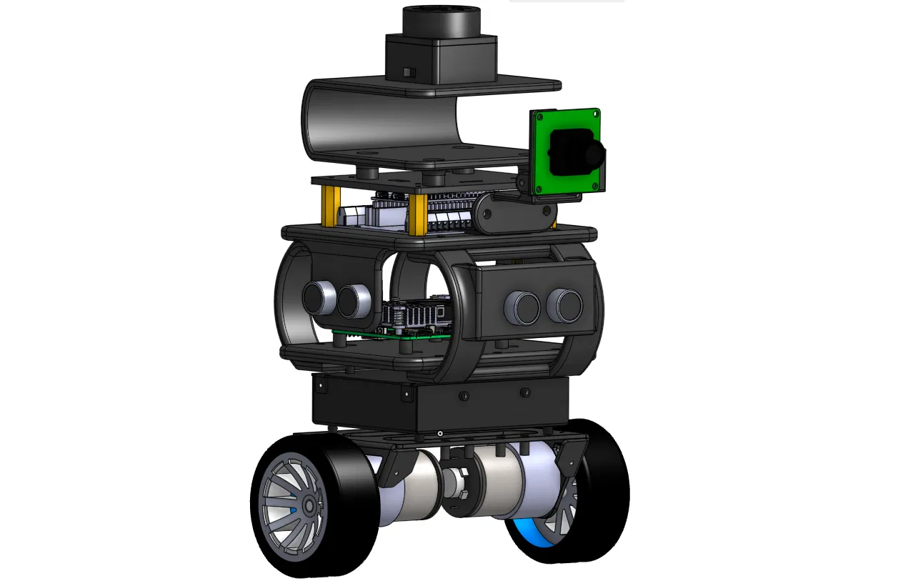

# PIVOT

**A two-wheeled self-balancing robot developed in ROS 2 and Gazebo, from a custom CAD model to closed-loop balance control.**

PIVOT is a simulation-first robotics project exploring the coupled dynamics of an inverted pendulum on two driven wheels. The current milestone is **autonomous upright balancing with wheel-velocity feedback and a bounded, encoder-equipped motor approximation**. The longer-term goal is a physical platform for motion control and autonomous navigation.

<p align="center">
  
</p>

> **Status — November 2026:** Autonomous balancing has been observed in Gazebo with the custom Yahboom MD520Z30 motor approximation. This is a reported simulation result, not a claim of physical-hardware validation or quantified disturbance-recovery performance.

## Project status

| Capability | Status |
| --- | --- |
| Custom CAD, mesh geometry, URDF/Xacro robot model | Implemented |
| Gazebo Sim integration and ROS 2 control | Implemented |
| IMU feedback and pitch PID | Implemented |
| Wheel-speed feedback through bounded lean-angle commands | Enabled in the balancing launch |
| Custom MD520Z30 actuator approximation and quantized encoder feedback | Implemented and integration-tested |
| Autonomous upright balancing with the updated motor model | Observed in simulation |
| Fixed-position holding | Implemented as an option; not validated/enabled in the balancing launch |
| Yaw damping / commanded turning | Not enabled or validated |
| Push recovery with measured performance criteria | Planned |
| Mapping, localization and autonomous navigation | Planned |
| Physical PIVOT hardware validation | Planned |

## Why a balancing robot?

A two-wheel inverted-pendulum robot cannot stand upright without continuous control. That makes PIVOT a useful system for studying how mechanical design, inertial properties, sensor feedback, control laws and actuator limits interact in simulation.

This project is also part of a broader hands-on robotics simulation roadmap, with lessons intended to transfer to mobile robots, manipulators and other embodied systems.

## System architecture

```text
                           ROS 2 / Gazebo Sim

       IMU orientation + pitch rate           /cmd_vel
                    |                           |
                    v                           v
             Pitch PID <---- desired lean <--- Wheel-speed loop
                    |                           ^
                    |                           |
                    v                    Quantized joint states
          Requested left/right torque             ^
                    |                             |
                    v                             |
            ros2_control effort interface         |
                    |                             |
                    v                             |
       MD520Z30 motor approximation ---------------+
                    |
                    v
               Gazebo physics
```

The balancing launch enables a velocity loop that adjusts the **desired pitch** from wheel-speed error. The inner pitch controller uses IMU feedback to request wheel torque. The custom hardware plugin constrains the torque actually applied to each joint and produces quantized encoder feedback. Direct speed-torque correction is disabled in the working balancing launch.

The PID gains currently retained are **Kp = 8.0, Ki = 0.0, Kd = 0.4**. The launch uses `speed_kp = 0.12`, `velocity_pitch_sign = +1.0` and `max_pitch_offset = 0.02 rad`. These are simulation settings, **not experimentally optimized gains for a physical robot**.

## ROS 2 packages

| Package | Purpose |
| --- | --- |
| [`pivot_description`](pivot_description/) | Robot links, joints, meshes, Xacro, Gazebo contact/sensor definitions |
| [`pivot_control`](pivot_control/) | Pitch/velocity controller, ROS 2 launch files and controller configuration |
| [`pivot_hardware`](pivot_hardware/) | Custom `gz_ros2_control` hardware plugin, motor limits and encoder approximation |

## Robot model

| Property | Current model |
| --- | --- |
| Robot type | Two-wheel inverted pendulum |
| Wheel radius | 33.5 mm |
| Wheel width | 27 mm |
| Wheel-center separation | 158 mm, based on URDF joint origins at Y = ±79 mm |
| Chassis mass in URDF | 1.225 kg (model estimate; not a complete measured robot mass) |
| Wheel mass in URDF | 0.0988 kg per wheel |
| IMU update rate | 200 Hz (configured) |
| Controller manager update rate | 200 Hz (configured) |

The CAD-inspired dimensions, inertias and collision approximations require further validation against assembled physical hardware. The URDF contains fixed sensor frames for the intended LiDAR, camera and ultrasonic sensors; **those physical sensor frames do not imply that complete perception/navigation pipelines are operational**.

### Reference frames

```text
base_footprint
└── base_link
    ├── left_wheel_link       (continuous)
    ├── right_wheel_link      (continuous)
    ├── imu_link              (fixed)
    ├── lidar_link            (fixed)
    └── camera / ultrasonic frames (fixed, as modeled)
```

In the current URDF, `base_footprint` and `base_link` are joined by a **fixed** joint. A time-varying world-to-robot pose transform is not yet published for RViz, so an RViz view fixed to the robot frame **cannot by itself demonstrate actual balance, drift or recovery**. Use Gazebo and telemetry for these checks.

## Motor and encoder simulation

The intended reference motor is a Yahboom **MD520Z30_12V** 30:1 encoder gearmotor. The `pivot_hardware` plugin improves on an ideal effort actuator by approximating:

- **0.32361945 N·m sustained torque ceiling per wheel**, drawn from the listed rated torque.
- **0.470719 N·m advertised stall torque**, tracked separately as a specification rather than used as the continuous operating ceiling.
- A provisional **333 RPM** speed reference and speed-dependent same-direction torque reduction.
- Opposing torque for braking; zero actuator torque for zero command.
- Independent constraints for each wheel.
- **1,320 counts per output-wheel revolution** in the encoder approximation.

These limits are **a model**, not a validated hardware digital twin. Battery voltage sag, PWM electrical behavior, thermal effects, backlash, and measured tire/ground friction are not yet reproduced. Source code and parameters live in [`pivot_hardware`](pivot_hardware/).

## Requirements

- Ubuntu 24.04 (development environment)
- ROS 2 Jazzy
- Gazebo Sim 8 / Harmonic integration (`ros_gz_sim`, `ros_gz_bridge`)
- `gz_ros2_control`, `ros2_control`, `ros2_controllers`
- `xacro`, `robot_state_publisher`, `joint_state_publisher` where needed, and `colcon`
- C++/Python build dependencies declared in the package manifests

## Build and launch

Clone the full repository into a ROS 2 workspace. The repository now contains **three packages**, not just `pivot_description`.

```bash
source /opt/ros/jazzy/setup.bash
mkdir -p ~/pivot_ws/src
cd ~/pivot_ws/src
git clone https://github.com/Muhd-Mahmud/Pivot.git

cd ~/pivot_ws
rosdep install --from-paths src --ignore-src -r -y
colcon build --symlink-install
source install/setup.bash

ros2 launch pivot_control spawn_balance.launch.py
```

The launch starts Gazebo, the robot model, the bridge, controller manager and the balancing node. Start with the robot upright, then inspect the Gazebo view and `balance_node` logs. The launch uses the existing pitch/velocity settings and leaves position hold and yaw damping off.

If this repository is being reviewed on a branch before merge, clone that branch explicitly or check it out after cloning.

## Validation and limitations

At the November 2026 milestone, the project had:

- Built all three ROS 2 packages successfully.
- Passed unit tests and an in-process integration test for the hardware plugin's limits, encoder behavior and controller lifecycle.
- Loaded the custom MD520Z30 hardware model in Gazebo with the advertised simulated torque constraints.
- Shown near-upright pitch readings with limited encoder-estimated displacement in a recorded run; stable balancing was subsequently reported by the developer.

A measured **60-second baseline with documented pass/fail criteria**, push-recovery trials, and tests on physical hardware remain important next steps. Encoder-integrated displacement is not the same as independently measured world displacement if wheels slip.

## Roadmap

1. Record a reproducible undisturbed stability baseline with pitch, encoder speed, requested and applied torque.
2. Measure forward/backward push recovery and identify saturation or oscillation.
3. Validate station holding and controlled movement without losing balance.
4. Add and tune differential yaw control.
5. Add world-frame visualization, localization, mapping and navigation.
6. Assemble physical PIVOT and identify motor and inertial parameters experimentally.

## Development approach

This repository tracks both implemented capabilities and unresolved limitations. The objective is reproducible robotics engineering: build, measure, document failures, then improve the system. Descriptions of the motor model and control gains are deliberately qualified where physical measurements are still missing.

## References

- [ROS 2 documentation](https://docs.ros.org/)
- [Gazebo documentation](https://gazebosim.org/docs/)
- [ROS REP-103 coordinate conventions](https://www.ros.org/reps/rep-0103.html)
- [Yahboom balancing-robot reference platform](https://category.yahboom.net/products/sbr-stm32)
